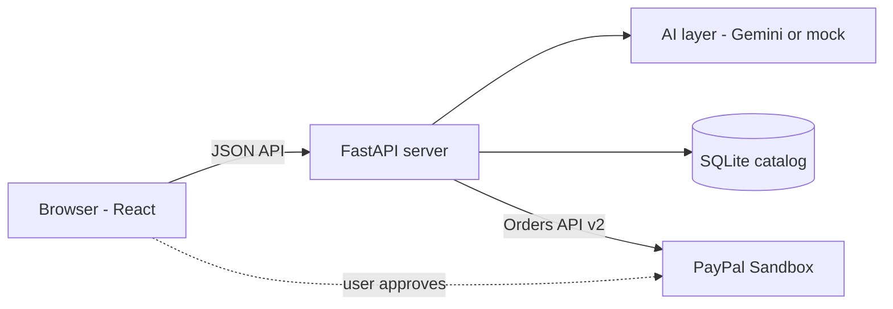
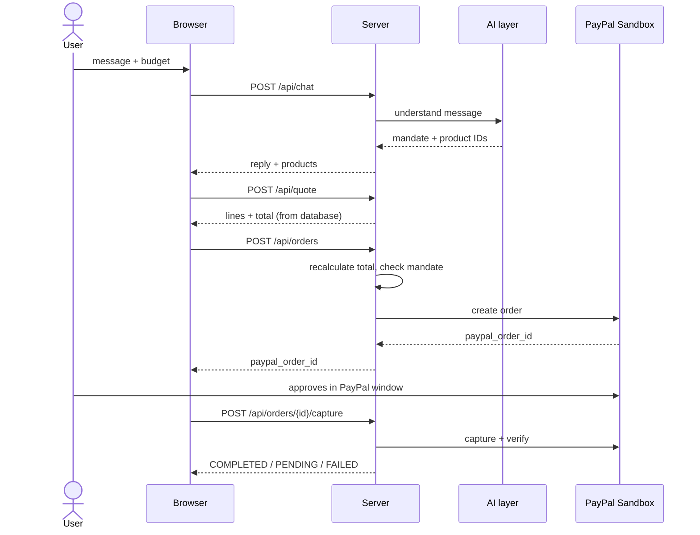

# Architecture

## Components

1. **Browser (React app)**
   Shows the chat (French, Arabic, English), the mandate, the suggested products and the quote. Opens the PayPal window. It never calculates or decides prices.

2. **FastAPI server**
   The central piece. It receives all requests, calls the AI, reads the catalog, enforces the mandate, recalculates every price and talks to PayPal. It is the only component that holds secrets.

3. **AI layer (Gemini or mock)**
   Understands the user's message, extracts the mandate (category, use, budget) and suggests up to 3 product IDs. In `mock` mode it returns fixed answers, so the app works without an API key. The AI has no access to payments.

4. **SQLite catalog**
   Stores the demo products (fictional names and prices) and the orders. It is the single source of truth for prices.

5. **PayPal Sandbox**
   PayPal's test environment. It creates the order, shows the approval window to the user and processes the capture. No real money.

## Payment flow (5 steps)

1. **Chat and mandate.** The user describes what they want. The AI extracts the mandate and suggests up to 3 products (`POST /api/chat`).
2. **Quote.** The user picks a product. The server reads the price from SQLite and returns a detailed quote (`POST /api/quote`).
3. **Create order.** The user clicks "Pay with PayPal". The server recalculates the total, checks it against the mandate (refuses with `MANDATE_EXCEEDED` if too high) and creates a PayPal order (`POST /api/orders`).
4. **User approval.** The PayPal window opens. The user logs in to a Sandbox account and approves (or cancels). If the user cancels or closes the window, the browser calls `POST /api/orders/{paypal_order_id}/cancel`. Nothing is paid without this click.
5. **Capture and confirmation.** The server captures the payment, checks the real status with PayPal and saves it (`POST /api/orders/{paypal_order_id}/capture`). The browser shows the result (`GET /api/orders/{order_id}`).

